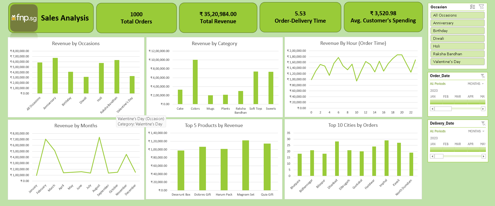

# FNP Sales Analysis Dashboard

## 📊 Project Overview

This project presents a **Sales Analysis Dashboard built using Microsoft Excel**. It provides an overview of sales performance, revenue trends, customer spending, product categories, and order distribution.

The dashboard helps visualize key business metrics and identify sales trends through charts, KPIs, and interactive filters.

## 🖼️ Dashboard Preview




## 📌 Key Performance Indicators (KPIs)

- **Total Orders:** 1,000
- **Total Revenue:** ₹35,20,984.00
- **Average Order-Delivery Time:** 5.53
- **Average Customer Spending:** ₹3,520.98

## 📈 Dashboard Features

- Revenue by Occasions
- Revenue by Product Category
- Revenue by Hour of Order
- Revenue by Months
- Top 5 Products by Revenue
- Top 10 Cities by Orders
- Occasion Filter
- Order Date Filter
- Delivery Date Filter

## 🛠️ Tools and Technologies

- Microsoft Excel
- Data Analysis
- Data Visualization
- Key Performance Indicators (KPIs)
- Business Reporting

## 🔍 Key Insights

- Anniversary generates the highest revenue among the displayed occasions.
- Colors is the highest-revenue category among the displayed product categories.
- Monthly revenue fluctuates throughout the year.
- The dashboard compares product revenue and order volumes across cities.

*These observations are based on the dashboard visualization and may require further analysis of the underlying dataset for validation.*

## 📁 Project Structure

```text
fnp-sales-analysis-dashboard/
├── Datasets/
│   ├── customers.xlsx
│   ├── orders.xlsx
│   ├── products.xlsx
│   └── Ferns and Petals Sales Analysis Problem Statement.pdf
├── README.md
├── Sales-dashboard.png
└── fnp-sales-analysis-dashboard.xlsx
```

## 🎯 Project Objective

The objective of this project is to demonstrate practical skills in sales data analysis, KPI monitoring, dashboard creation, data visualization, and business reporting using Microsoft Excel.

## ⚠️ Disclaimer

This is a data analytics portfolio project and does not imply official affiliation with or endorsement by FNP. Company data and materials should only be shared when appropriate authorization has been obtained.

## 👤 Author
**Viki Neye**
**Data Analytics Portfolio Project**
